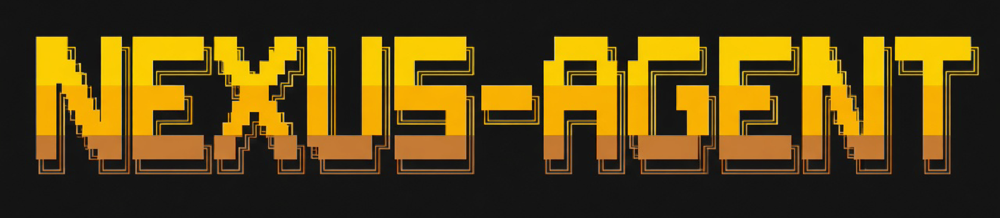

<p align="center">
  
</p>

<div align="center">

# Nexus Agent Harness

**An MIT-licensed Hermes fork — secure collaborative agent harness, CLI/TUI first.**

[](LICENSE)
[](https://github.com/NousResearch/hermes-agent)
[](#get-started)
[](#status)
[](#status)

`hermes` · `hermes --tui` · Linux now · Desktop later

[How it works](#how-it-works) ·
[Status](#status) ·
[Get started](#get-started) ·
[First run](docs/GETTING_STARTED.md) ·
[Secure defaults](docs/SECURE_DEFAULTS.md) ·
[Gateway](docs/GATEWAY.md) ·
[Providers](docs/PROVIDERS.md) ·
[Windows](docs/WINDOWS.md) ·
[Doctor](docs/DOCTOR.md) ·
[Upstream](#upstream) ·
[License](#license-and-credits)

</div>

---

| | |
|---|---|
| **Terminal-first** | Classic CLI plus Ink TUI — multiline chat, slash commands, streaming tools. |
| **Same agent core** | Sessions, skills, memory, and providers from upstream Hermes. |
| **Private dev + public install** | Day-to-day work is in [`nexus-agent-harness-dev`](https://github.com/codeflunky/nexus-agent-harness-dev); one-liners clone the public [`nexus-agent-harness`](https://github.com/codeflunky/nexus-agent-harness) mirror. |
| **Desktop later** | Windows/macOS desktop packaging is a later milestone, not the current focus. |

## How it works

1. **Provision** — `setup-hermes.sh` / `source ./activate` installs the PM-pinned Python 3.14 toolchain, Node, pnpm, and deps.
2. **Talk** — `hermes` opens the classic CLI; `hermes --tui` launches the modern terminal UI (needs a TTY and Node ≥ 20).
3. **Configure** — `hermes setup` / `hermes model` / `hermes doctor` wire providers and check the install.
4. **Extend** — skills, plugins, gateway channels, and cron stay available from upstream; we prioritize hardening the harness surface next.

## Get started

**Linux (public install clone):**

```bash
git clone https://github.com/codeflunky/nexus-agent-harness
cd nexus-agent-harness
bash setup-hermes.sh --runtime-only --test-environment
source ./activate          # each new shell
hermes --version
hermes doctor
```

Contributors: clone [`nexus-agent-harness-dev`](https://github.com/codeflunky/nexus-agent-harness-dev) (private) instead. Publishing the public mirror: [docs/PUBLISH.md](docs/PUBLISH.md).

**TUI (interactive terminal):**

```bash
just js-install            # once, after activate
pnpm --dir ui-tui run build
hermes --tui
```

Without a TTY, `hermes --tui` exits with `hermes-tui: no TTY` (expected in CI/pipes). Use a real terminal for interactive TUI.

**Useful commands:**

```bash
hermes              # classic interactive CLI
hermes --tui        # Ink TUI
hermes model        # pick provider / model
hermes setup        # wizard
hermes doctor       # diagnose the install
```

**First run (setup → model → chat/TUI):** [docs/GETTING_STARTED.md](docs/GETTING_STARTED.md).

**Secure defaults (approvals / secrets / egress):** [docs/SECURE_DEFAULTS.md](docs/SECURE_DEFAULTS.md).

**Gateway (Telegram / Discord / Slack / Microsoft Teams):** [docs/GATEWAY.md](docs/GATEWAY.md).

**Providers (Bedrock / Mantle / GovCloud):** [docs/PROVIDERS.md](docs/PROVIDERS.md).

**Windows (WSL2 or native PowerShell):** [docs/WINDOWS.md](docs/WINDOWS.md) — public one-liner via `HERMES_REPO_URL` → `codeflunky/nexus-agent-harness`.

Expected doctor warnings (missing `.env`, API keys, optional Docker, etc.): [docs/DOCTOR.md](docs/DOCTOR.md).

Upstream CDN one-liners and Desktop packages still belong to [NousResearch/hermes-agent](https://github.com/NousResearch/hermes-agent). For Nexus, use the public mirror installers in [docs/WINDOWS.md](docs/WINDOWS.md).

## Status

> [!IMPORTANT]
> **Status:** M1 (CLI/TUI Linux baseline) complete. What works today, what is partial, and what's next:
>
> - **Works today (Linux):** import of [NousResearch/hermes-agent](https://github.com/NousResearch/hermes-agent); MIT + [NOTICE](NOTICE); Nexus branding; PM setup; `hermes` / TUI build; [first-run path](docs/GETTING_STARTED.md); [secure defaults](docs/SECURE_DEFAULTS.md); [gateway recipes](docs/GATEWAY.md); monthly upstream sync cadence; Nexus smoke CI (incl. `just nexus-evals`); protected fork markers. **M1–M3 complete.**
> - **Partly there:** interactive chat still needs a real provider key; gateway tokens optional; Desktop later.
> - **Next:** M4 Desktop (later) — [docs/STATUS.md](docs/STATUS.md). Providers (Bedrock · local · OAuth · OpenRouter): [docs/PROVIDERS.md](docs/PROVIDERS.md).

## Upstream

Private **`-dev`** is the working fork; public **`nexus-agent-harness`** is the install mirror ([docs/PUBLISH.md](docs/PUBLISH.md)). Hermes stays a git remote only:

```bash
git remote add upstream https://github.com/NousResearch/hermes-agent.git   # once
git fetch upstream
git merge upstream/main   # or rebase, on a working branch
```

Details and sync notes: [docs/UPSTREAM.md](docs/UPSTREAM.md).

## License and credits

Nexus Agent Harness is licensed under the [MIT License](LICENSE).

- Upstream Hermes Agent © Nous Research — [https://github.com/NousResearch/hermes-agent](https://github.com/NousResearch/hermes-agent)
- Required third-party notices (including Apache-2.0 attribution for `plugins/security-guidance`) are in [NOTICE](NOTICE)

Bundled skills and plugins may keep their own `LICENSE` files; those terms still apply to those components.
